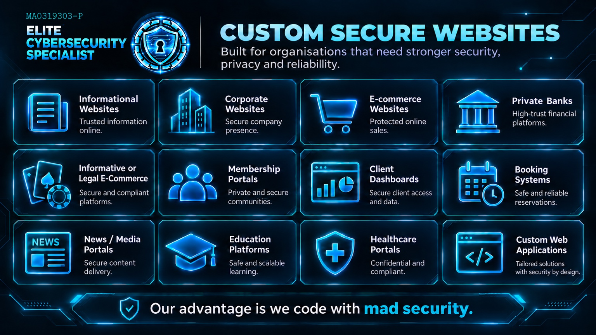
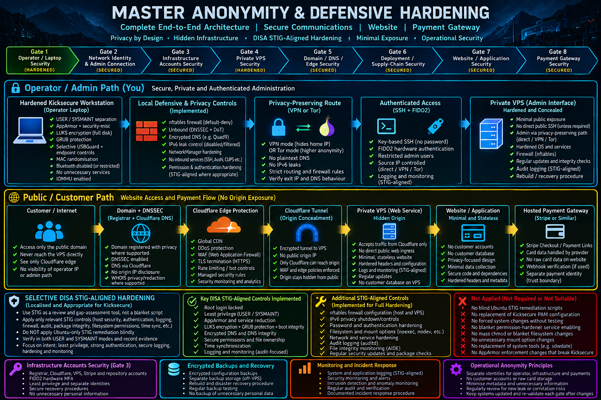
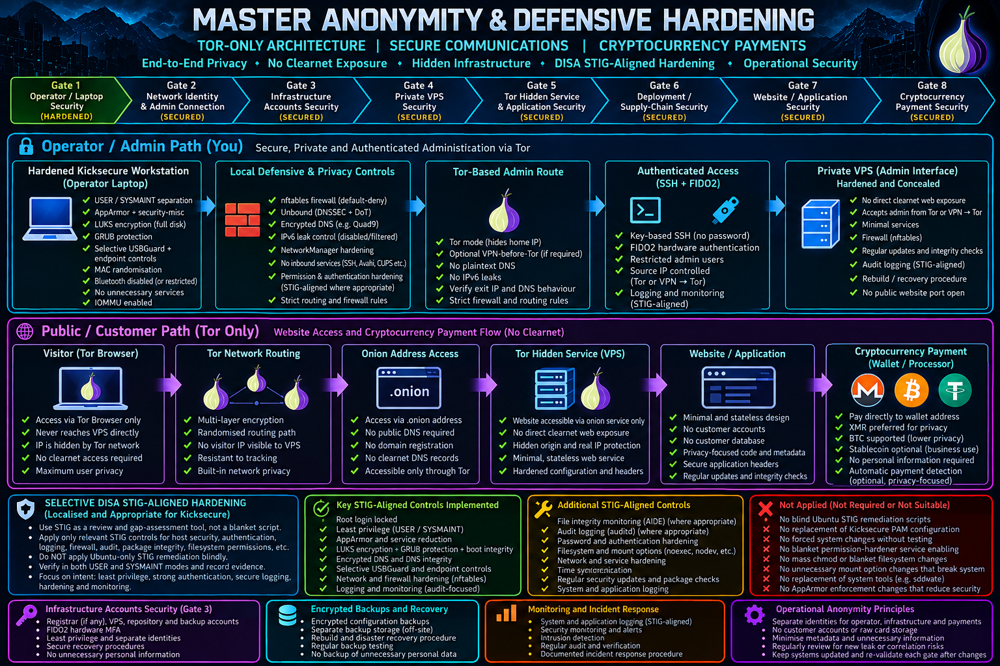

<p align="center">
  
</p>

# ECS — CUSTOM SECURE WEBSITES

### High-Assurance Hosting Hardening · Security-First Website Engineering · Privacy-Conscious Infrastructure

**ELITE CYBERSECURITY SPECIALIST · MALAYSIA**  
**HARDEN. TEST. VERIFY. IMPROVE.**  
**Public architectural overview · October 2026**

**[Download Company Profile](https://github.com/elite-cybersecurity-specialist/company-profile/raw/refs/heads/main/pdf/ECS_Company_Profile.pdf)** · **[View Other Cybersecurity Subjects](https://github.com/elite-cybersecurity-specialist)** · **[Kicksecure High-Assurance Hardening Project](https://github.com/elite-cybersecurity-specialist/hardening-challenge)**

> **Our advantage: We code with mad security.**  
> Harden the hosting system. Embed defenses into the website. Protect administration and infrastructure. Test the weaknesses. Verify the protection.

We build and harden websites for organisations requiring stronger **security, privacy and reliability**. Our foundation is **deep hosting/system hardening and defensive security within the website source code**. WAF, CDN, DDoS mitigation and managed security offerings are additional layers recommended where risk, architecture and budget justify them — not substitutes for secure systems and secure code.

**Architecture status:** The diagrams below illustrate proposed/reference architectures and control objectives. A marked control in a diagram is **not** a claim that all listed controls have been deployed or independently certified for a customer. Actual implementation is determined, tested and recorded per engagement.

---

## Contents

- [Our Security Foundation](#our-security-foundation)
- [How We Harden Websites](#how-we-harden-websites)
- [Two Website Security Architectures](#two-website-security-architectures)
  - [Method 1 — Secure Public Internet](#method-1--secure-public-internet)
  - [Method 2 — Tor Private Internet](#method-2--tor-private-internet)
- [Eight Security Gates](#eight-security-gates)
- [Hosting & Infrastructure Hardening](#hosting--infrastructure-hardening)
- [Security Embedded in Website Code](#security-embedded-in-website-code)
- [Additional Protective Services](#additional-protective-services)
- [Websites & Applications We Can Secure](#websites--applications-we-can-secure)
- [Security Engineering Methodology](#security-engineering-methodology)
- [Evidence, Privacy & Technical Documents](#evidence-privacy--technical-documents)
- [Frameworks & References](#frameworks--references)
- [Customer Engagement & Contact](#customer-engagement--contact)

---

## Our Security Foundation

**First, harden the host. Then, harden the website itself.** We do not treat a WAF subscription or a collection of HTTP headers as a complete website-security strategy.

| Security foundation | Engineering focus | Intended outcome |
|---|---|---|
| **1. Hosting / operating system** | Platform-specific CIS Benchmark Level 2 recommendations where suitable; applicable DISA STIG/SRG objectives; service minimisation, privilege boundaries, network exposure, SSH, TLS, logging, integrity and recoverability | Reduced attack surface and more resilient hosting |
| **2. Website files and application logic** | Secure server-side code, authentication and authorization, session security, validation, output encoding, injection defenses, API restrictions, secrets and dependency controls | Defenses enforced by the application itself |
| **3. Security testing and evidence** | Threat modeling; approved black-, gray- or white-box assessments; baseline/configuration evidence, runtime tests, remediation, retesting and rollback | Verifiable protection, not a configuration-only claim |
| **4. Optional additional protection** | WAF, CDN, bot management, DDoS mitigation, edge rate limits, managed detection, specialist DNS or payment services as required | Additional defense in depth matched to risk |

**Key principle:** Secure hosting and secure website code must work together without breaking legitimate functionality. Controls are assessed for effectiveness, compatibility and operational impact before deployment.

## How We Harden Websites

```text
CUSTOMER THREAT MODEL & SERVICE REQUIREMENTS
                  ↓
  HOSTING / OS / WEB-SERVER HARDENING
     (CIS L2 / applicable STIG-SRG)
                  ↓
      WEBSITE SOURCE-CODE SECURITY
   (OWASP / application-specific controls)
                  ↓
   ADMIN ACCESS + DEPLOYMENT SECURITY
                  ↓
       AUTHORIZED SECURITY TESTING
                  ↓
    REMEDIATE → RETEST → DOCUMENT
                  ↓
      MONITOR → BACKUP → MAINTAIN
                  +
     OPTIONAL EDGE / WAF / DDoS / CDN
```

The hosting model matters: dedicated VPS and bare-metal deployments allow more OS-level control than shared hosting, while managed cloud and serverless systems require controls at the platform, IAM, network and application layers.

---

## Two Website Security Architectures

Both designs separate the **operator / administrative path** from the **visitor / customer path** and protect the supporting infrastructure. They are alternative architectures selected according to service requirements, not interchangeable promises of invisibility.

### Method 1 — Secure Public Internet

<p align="center">
  
</p>

**Purpose:** For organisations needing a conventional public domain accessible through ordinary browsers, with protected administration, minimal public exposure and externalised payment processing when appropriate.

**Operator / admin path:** Hardened Kicksecure workstation → approved privacy-conscious route (VPN or Tor, if suitable) → authenticated, restricted administration (e.g. SSH keys and hardware-backed MFA through a supported access gateway) → private, hardened VPS.

**Visitor / customer path:** Customer → domain/DNS → optional protected edge (CDN, WAF, DDoS controls) → authenticated tunnel or access-restricted origin → hardened web service and minimal application → externally hosted payment provider, where needed.

**Security decisions:**

- Keep management interfaces off the public website path; limit administrative identities, keys and privilege.
- Where a proxy/tunnel is used, configure origin firewall and ingress policy to prevent unintended bypass. Merely hiding a DNS record is insufficient.
- Use modern TLS; protect secrets; securely validate any payment webhook using the provider's documented signature/replay controls.
- A stateless design and outsourced payments can reduce stored sensitive data, but are not suitable for every application.
- Review availability dependencies and continuity planning: edge providers and tunnels introduce external dependencies.

**[Technical architecture and trust boundaries →](docs/ARCHITECTURES.md#method-1--secure-public-internet)**

### Method 2 — Tor Private Internet

<p align="center">
  
</p>

**Purpose:** For lawful, privacy-sensitive websites that do not need conventional public-web accessibility. Visitors use Tor Browser and an **onion address** rather than a normal public domain.

**Operator / admin path:** Hardened workstation → Tor-aware, segmented administrative route → restricted authentication → hardened private infrastructure. Management authentication remains essential even when Tor is used.

**Visitor / customer path:** Tor Browser → onion service → least-privilege web service → minimal application → separate payment workflow if the customer requires one.

**Security decisions:**

- Restrict the service so that the web application is not accidentally reachable over conventional public ingress; test exposure across all interfaces and IP families.
- Protect onion-service keys and system backups; maintain application security and hardened administration.
- Tor limits direct network-address disclosure under the intended configuration; it does **not** remove browser, endpoint, payment, correlation or application-level risks.
- Cryptocurrency payments are optional. A cryptocurrency transfer is **not inherently anonymous**, and payment choice must satisfy customer compliance and accounting obligations.
- Implement monitoring, abuse controls, service recovery and appropriate legal/compliance review without undermining the privacy requirements.

**[Technical architecture and trust boundaries →](docs/ARCHITECTURES.md#method-2--tor-private-internet)**

---

## Eight Security Gates

The images organise the complete architecture into eight gates. These are **engineering workstreams**, not a statement that every gate has passed an audit.

| Gate | Domain | What ECS reviews and secures |
|---|---|---|
| **01** | **Operator / Laptop Security** | Hardened workstation, disk encryption, separated privilege, endpoint policy and controlled administration |
| **02** | **Network Identity & Admin Connection** | Secure administrative connectivity, route policy, DNS leak prevention and identity separation where justified |
| **03** | **Infrastructure Accounts Security** | Registrar, DNS, edge, VPS, code repository and backup-account MFA, least privilege, recovery and logging |
| **04** | **Private VPS Security** | Operating system, SSH/admin access, service exposure, firewall, mandatory access controls, integrity and recovery |
| **05** | **Domain, DNS & Edge / Onion Service** | Public DNS/DNSSEC/edge defenses **or** onion-service exposure and key management |
| **06** | **Deployment & Supply Chain** | Build provenance, dependency control, secrets, release approvals, rollback, CI/CD and artifact integrity |
| **07** | **Website / Application Security** | Security embedded in source, trust boundaries, sessions, access controls, APIs and secure data handling |
| **08** | **Payment Security** | Hosted checkout and verified webhooks, or risk-assessed private payment architecture where lawful and appropriate |

See [Security gate engineering checklist](docs/SECURITY_GATES.md).

## Hosting & Infrastructure Hardening

Our hosting hardening approach takes inspiration from the discipline shown in [KHAHP — Kicksecure High-Assurance Hardening Project](https://github.com/elite-cybersecurity-specialist/hardening-challenge) and adapts it to **the actual web-hosting technology**.

| Control domain | Example security objectives |
|---|---|
| Platform / kernel | Supported OS, trustworthy updates, minimal modules, applicable kernel and runtime policy |
| Accounts / privilege | No unnecessary administrator exposure, role separation, MFA for management, restricted service identities |
| SSH / remote admin | Keys, access boundaries, secure algorithms, logging, break-glass procedure; supported hardware-backed MFA where available |
| Firewall / network | Default-deny principles, ingress and egress review, private management paths, IPv4/IPv6 parity |
| Web server / TLS | Minimal modules, safe routing, transport security, reverse-proxy boundary checks |
| Filesystem / isolation | Secure permissions, restricted write paths, dedicated service users, AppArmor/SELinux where suitable |
| Logging / integrity | Centralised or tamper-resistant logs, integrity monitoring, alerting, sensitive-data minimisation |
| Backups / resilience | Encrypted offline/off-site recovery paths, restore rehearsal, patch/rollback evidence |

CIS Level 2 is a **defense-in-depth benchmark profile**, not a requirement to force every recommendation onto every production stack. DISA STIG/SRG guidance is likewise selected by platform and applicability; ECS does **not** blindly apply unrelated remediation scripts or claim DISA/CIS certification without a formal process.

**[Detailed hosting hardening methodology →](docs/HOSTING_HARDENING.md)**

## Security Embedded in Website Code

We engineer defensive controls **in server-side logic, configuration, templates, API handlers, build pipelines and deployment workflows**, not just in frontend scripts that users can modify.

| Website-code security area | Defensive design |
|---|---|
| Authentication | Phishing-resistant MFA where feasible, protected login/reset, rate controls, safe credential storage |
| Authorization | Deny by default; enforce object- and function-level authorization on the server for every operation |
| Sessions | Secure, HttpOnly, SameSite cookies where appropriate; rotation, timeout, invalidation and CSRF defense |
| Inputs / outputs | Contextual escaping, schema validation, safe parsing, parameterised database operations |
| Security headers | Risk-tested CSP, HSTS, clickjacking defenses, referrer and content-type policies |
| Uploads / files | Strict type and size checks, isolated storage, non-executable upload areas and malware handling as needed |
| APIs / abuse | Token scope, per-object access checks, throttling, replay/retry design and resource limits |
| Secrets / dependencies | No secrets in repo or frontend bundle; pinned/verified dependencies and patched build chain |
| Privacy / errors | Minimise personal data, suppress internal traces, avoid secret leakage in logs and responses |
| Payment flow | Hosted payment processing when suitable, strong webhook authenticity and idempotency |

**[Detailed secure-code requirements →](docs/WEBSITE_CODE_SECURITY.md)**

## Additional Protective Services

ECS may recommend these **after** evaluating the application and hosting threat model:

- **WAF / managed application security rules** for eligible public internet services.
- **CDN and DDoS protection** for availability, edge filtering and performance requirements.
- **Bot and rate-limit defenses** for login abuse, scraping, inventory or API misuse.
- **Managed monitoring, log analysis and incident response** where operational support is needed.
- **Security-focused DNS, secrets, backup and recovery services** where they improve resilience.

**A WAF is not a substitute for fixing broken access control, insecure code or an exposed origin.** For Tor-only services, conventional public-CDN/WAF patterns may not apply; controls must be selected for the onion-service architecture.

## Websites & Applications We Can Secure

| Website / application | Typical scope |
|---|---|
| Informational websites | Minimal content exposure, clean deployment and hardened administration |
| Corporate websites | Company presence, secure administration and production hosting |
| E-commerce websites | Catalogue, orders, hosted checkout and payment trust boundaries |
| Private banking portals | Risk-scoped identity, access, infrastructure and applicable regulatory controls |
| Informative or lawful e-commerce gaming sites | Authorised jurisdiction-aware website and payment security |
| Membership portals | Restricted content, account lifecycle, entitlements and access controls |
| Client dashboards | Secure client access, API authorization and data isolation |
| Booking / reservation systems | Workflow integrity, protected payments and sensitive-data handling |
| News / media portals | Secure publishing, administrator protection and availability |
| Education platforms | Role separation, student privacy and secure workflows |
| Healthcare portals | Confidential access, data protection and applicable obligations |
| Custom web applications | Purpose-built security architecture suited to customer requirements |

## Security Engineering Methodology

**HARDEN → TEST → VALIDATE → REMEDIATE → RE-TEST → MAINTAIN**

1. **Define scope:** Customer assets, hosting ownership, lawful authorisation, business-critical paths, threat model and agreed test boundaries.
2. **Baseline:** Record system version, attack surface, web stack, current controls and backup/rollback readiness.
3. **Harden:** Apply platform-compatible OS/web-server controls and integrate security into application code.
4. **Test & validate:** Functional acceptance plus approved security tests against the host, edge, application, APIs and administration.
5. **Remediate & re-test:** Correct confirmed weaknesses, document compatibility exceptions, validate the fix and preserve recovery capability.
6. **Maintain:** Monitor, update, re-assess changes, test backups and review third-party dependencies.

We separate **recommended**, **implemented**, **functionally tested** and **independently assessed** controls. No customer configuration or deployment is represented as complete merely because a reference diagram describes it.

**[Engagement and verification methodology →](docs/ENGAGEMENT_AND_VERIFICATION.md)**

## Evidence, Privacy & Technical Documents

| Document | Purpose |
|---|---|
| [Reference Architectures](docs/ARCHITECTURES.md) | Operator/customer paths, public edge vs. Tor-only design, trust boundaries and limitations |
| [Eight Security Gates](docs/SECURITY_GATES.md) | Full gate-by-gate engineering and assurance checklist |
| [Hosting Hardening](docs/HOSTING_HARDENING.md) | CIS Level 2 and STIG/SRG-informed host hardening, compatibility and verification |
| [Website Code Security](docs/WEBSITE_CODE_SECURITY.md) | Secure code, authentication, access controls, APIs, headers, secrets and payments |
| [Engagement & Verification](docs/ENGAGEMENT_AND_VERIFICATION.md) | Scoping, baseline, acceptance criteria, evidence, rollback, re-testing, maintenance |
| [Framework Reference](docs/FRAMEWORK_REFERENCE.md) | Framework applicability, interpretation and primary source links |
| [Security Policy](SECURITY.md) | Coordinated vulnerability reporting and authorisation boundary |

**We do not publicly publish customer IP addresses, hostnames, private firewall rules, credentials, recovery secrets, onion-service private keys, internal exceptions or raw sensitive security logs.** Public documentation explains the architectural methodology; client implementation records remain confidential.

## Frameworks & References

Our work is informed by **CIS Benchmarks, applicable DISA STIG/SRG guidance, OWASP ASVS 5.0, OWASP API Security, NIST security principles and secure-by-design practices**. See [Framework Reference](docs/FRAMEWORK_REFERENCE.md) for authoritative resources and scope boundaries.

**Framework alignment is not formal accreditation or certification.** Assessment and applicability depend on the customer environment and agreed contract.

## Customer Engagement & Contact

**ELITE CYBERSECURITY SPECIALIST**  
Business registration: **202403184091 (MA0319303-P)**  
Malaysia

**Yuhisern Navaratnam** — Founder · Cybersecurity Engineer  
**Email:** [Yuhisern@protonmail.com](mailto:Yuhisern@protonmail.com)  
**WhatsApp:** [+60 17-279 1717](https://wa.me/60172791717)

**[Download Company Profile (PDF)](https://github.com/elite-cybersecurity-specialist/company-profile/raw/refs/heads/main/pdf/ECS_Company_Profile.pdf)** · **[Explore All ECS Cybersecurity Subjects](https://github.com/elite-cybersecurity-specialist)**

> **HARDEN. TEST. VERIFY. IMPROVE.**  
> We secure the hosting foundation, engineer security into the website, protect access and infrastructure, and verify that the defenses work.

---

<sub>Elite Cybersecurity Specialist · Custom Secure Websites · October 2026 · Architectural and engineering overview. The three original ECS illustrations are presented without image alteration. All security implementations must be scoped, implemented, tested and documented for the actual customer environment.</sub>
